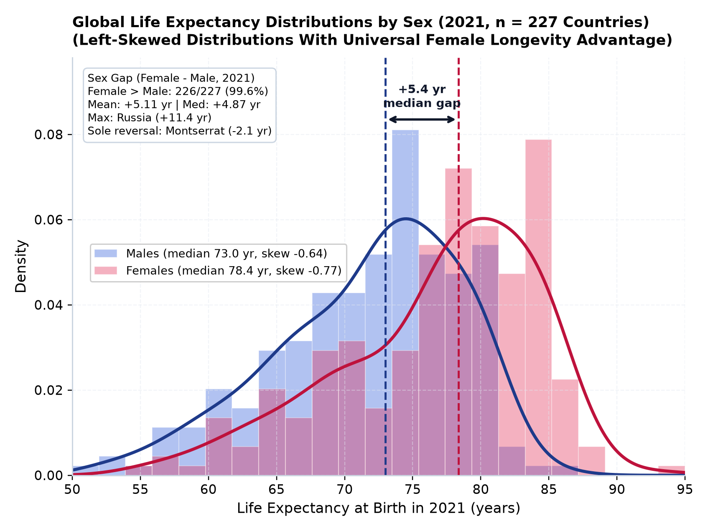
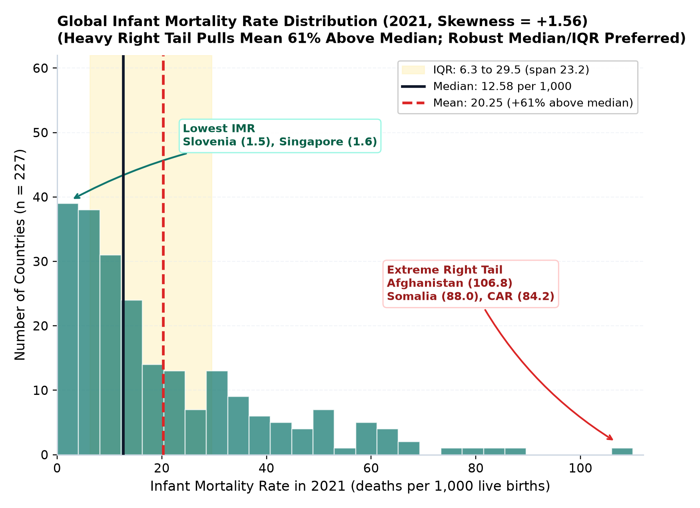
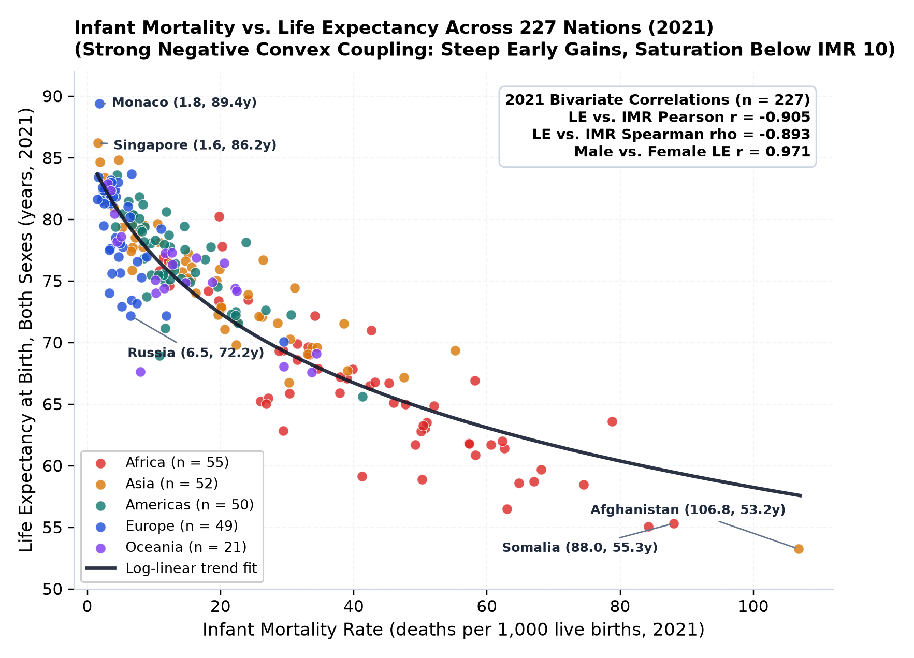
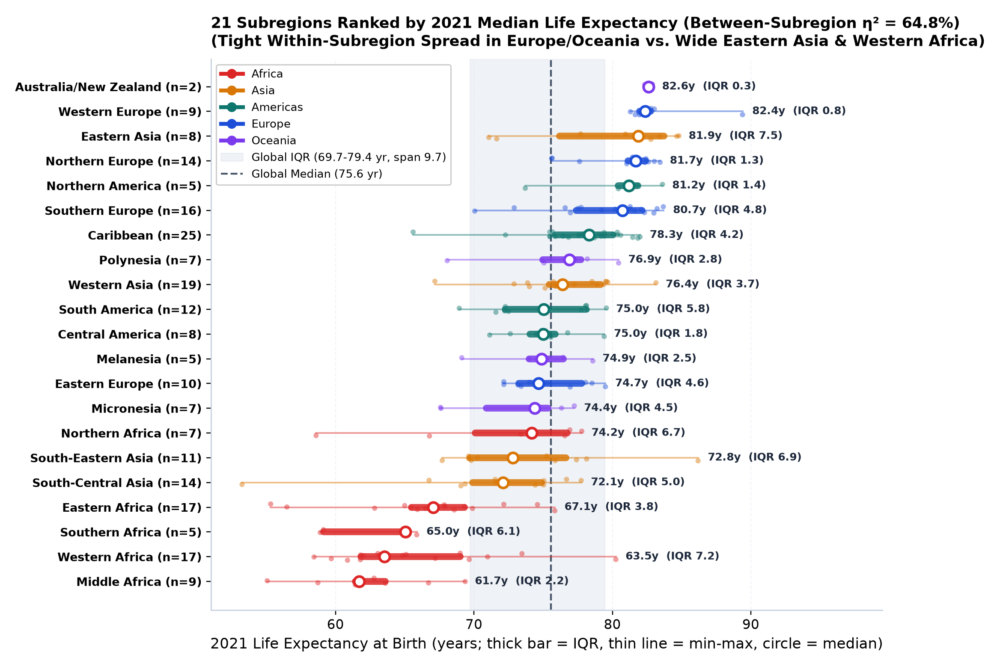
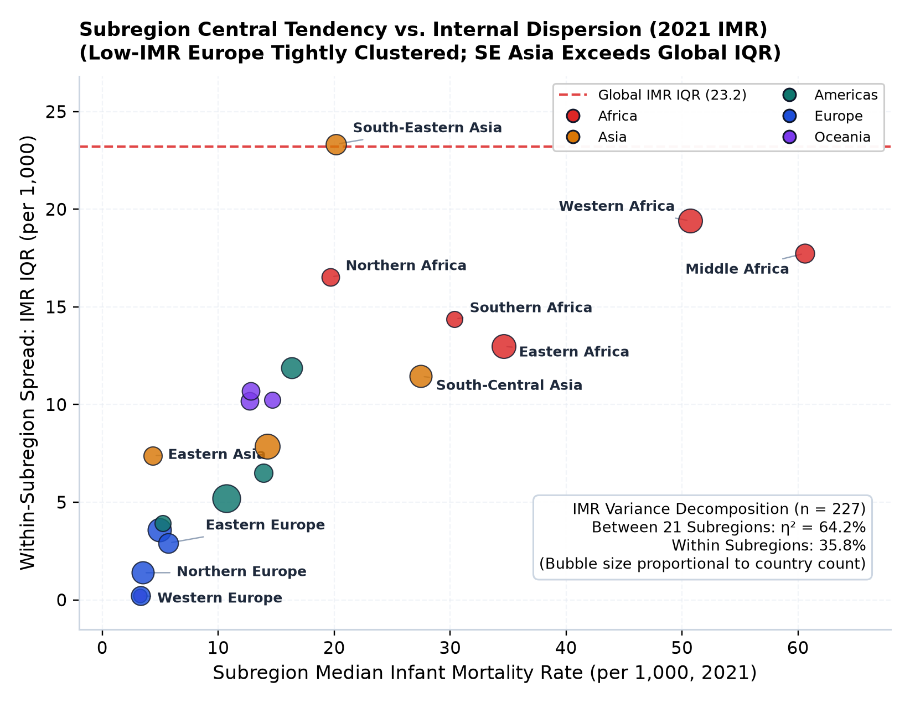
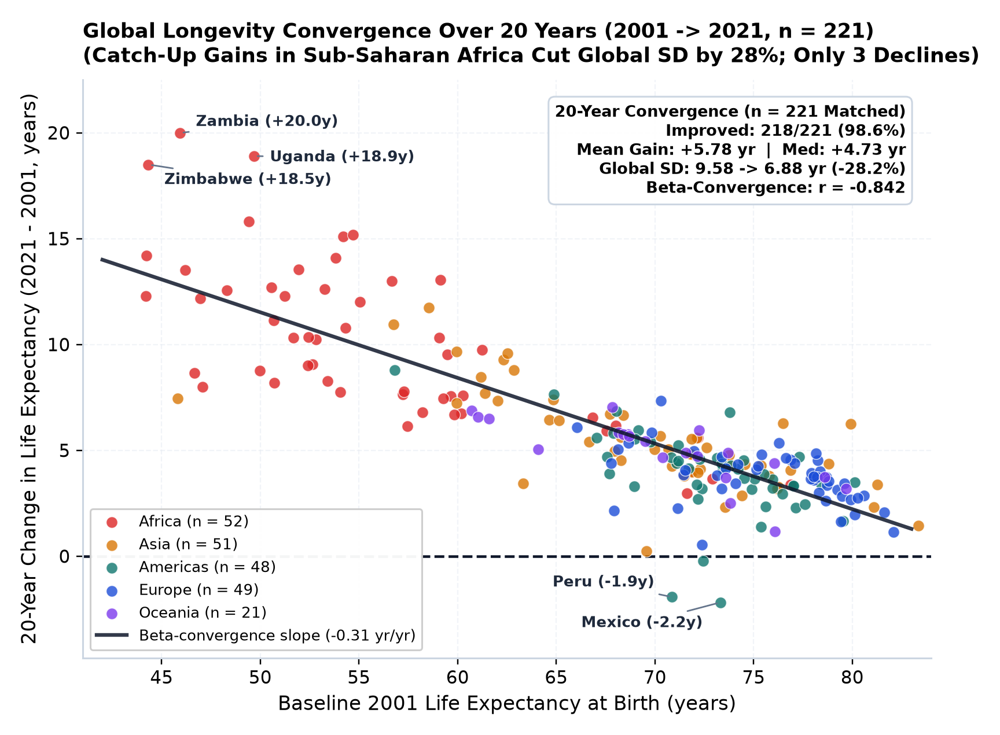

# Descriptive Demographic Analysis: Global Longevity & Infant Mortality (2001 vs. 2021)

Exploratory and descriptive demographic study of life expectancy at birth and infant mortality across `227` countries and territories (`5` world regions, `21` geographic subregions) from the U.S. Census Bureau International Data Base (IDB), completed as Report 1 for *Introductory Case Studies* (Winter Semester 2022/23, TU Dortmund University, Department of Statistics: Prof. Dr. Jörg Rahnenführer, Dr. Franziska Kappenberg, and M.Sc. Marieke Stolte).

## Study Overview

Using `data/census2001_2021.csv` (`454` rows = `227` nations in `2001` and `2021`), this project addresses four core demographic questions using parametric and robust descriptive statistics, dual correlation analysis, exact variance decomposition, and paired longitudinal tracking:

1. **2021 Frequency Distributions & Sex Gap (`n = 227`):** Characterize global distributions of Life Expectancy at Birth (Both Sexes, Males, Females), Infant Mortality Rate (deaths per 1,000 live births), and the national Female-minus-Male longevity gap.
2. **2021 Bivariate Correlations (`n = 227`):** Measure linear (`Pearson r`) and monotone rank (`Spearman rho`) relationships between life expectancy and infant mortality, capturing the convex saturation curve below `IMR = 10`.
3. **Subregion Homogeneity vs. Between-Subregion Heterogeneity (`21` Subregions):** Quantify within- vs. between-subregion dispersion via exact variance decomposition ($\eta^2 = \text{SS}_B / \text{SS}_T$) and compare each subregion's internal IQR against global variability.
4. **20-Year Global Convergence (`2001 -> 2021`, `n = 221` Matched Countries):** Audit missing baseline data (`6` countries missing in 2001: Libya, Puerto Rico, South Sudan, Sudan, Syria, and United States) and evaluate paired 20-year changes, sigma-convergence (dispersion narrowing), and beta-convergence (catch-up gains).

## Task 1: 2021 Global Distributions & Sex Longevity Gap (`n = 227`)

| Variable (2021) | n | Mean | SD | Median | IQR | Min | Max | Skewness |
| :--- | :---: | ---: | ---: | ---: | ---: | ---: | ---: | ---: |
| Life Expectancy, Both Sexes (yr) | 227 | 74.28 | 6.91 | 75.56 | 9.70 | 53.25 | 89.40 | -0.73 |
| Life Expectancy, Males (yr) | 227 | 71.78 | 6.74 | 72.99 | 9.36 | 51.73 | 85.55 | -0.65 |
| Life Expectancy, Females (yr) | 227 | 76.89 | 7.21 | 78.36 | 10.05 | 54.85 | 93.40 | -0.78 |
| Sex Gap: Female - Male (yr) | 227 | +5.11 | 1.74 | +4.87 | 2.23 | -2.11 | +11.44 | +0.62 |
| Infant Mortality Rate (per 1,000) | 227 | 20.25 | 19.19 | 12.58 | 23.21 | 1.53 | 106.75 | +1.56 |

- **Asymmetry & Robust Location:** Life expectancy is left-skewed (`skew = -0.73`, spanning `36.15` years from Afghanistan `53.25 yr` to Monaco `89.40 yr`), while infant mortality is strongly right-skewed (`skew = +1.56`, pulling the global mean `20.25` `+61%` above the median `12.58`; spanning Slovenia `1.53` and Singapore `1.56` to Afghanistan `106.75`). Robust median and IQR summaries are therefore paired with mean and SD throughout.
- **Universal Female Longevity Advantage:** Females outlive males in `226 / 227` countries (`99.6%`) by a mean of `+5.11 yr` (median `+4.87 yr`). The widest gaps cluster in Eastern Europe and post-Soviet states (`Russia +11.44 yr`, `Belarus +11.14 yr`, `Lithuania +11.06 yr`), while `Montserrat` (`-2.11 yr`, Male `76.52` vs. Female `74.41`) is the sole reversal.





## Task 2: 2021 Bivariate Correlations (`n = 227`)

| Variable Pair (2021) | Pearson r | Spearman rho |
| :--- | ---: | ---: |
| Life Expectancy (Both) vs. Infant Mortality | **-0.9049** | **-0.8929** |
| Life Expectancy (Females) vs. Infant Mortality | -0.9134 | -0.9100 |
| Life Expectancy (Males) vs. Infant Mortality | -0.8831 | -0.8650 |
| Life Expectancy (Males) vs. Life Expectancy (Females) | **+0.9710** | +0.9587 |

Infant mortality and life expectancy exhibit a tight negative, convex relationship: reducing infant mortality from `100` to `20` per 1,000 coincides with roughly `20+` additional years of life expectancy, whereas once infant mortality drops below `10`, longevity differences are increasingly driven by adult cardiovascular, lifestyle, and healthcare factors (visible in countries such as Russia, with low IMR `6.5` yet `72.2 yr` life expectancy).



## Task 3: Within- vs. Between-Subregion Variance Decomposition (`21` Subregions, 2021)

Exact sum-of-squares decomposition across all `227` countries separates between-subregion heterogeneity from within-subregion spread:

| Metric (2021) | Between 21 Subregions ($\eta^2$) | Within Subregions ($1 - \eta^2$) | Between 5 Regions ($\eta^2$) |
| :--- | ---: | ---: | ---: |
| Life Expectancy (Both Sexes) | **64.8%** (`0.6481`) | 35.2% (`0.3519`) | 51.1% (`0.5113`) |
| Infant Mortality Rate | **64.2%** (`0.6421`) | 35.8% (`0.3579`) | 52.0% (`0.5204`) |

Nearly two-thirds of total global variance in both indicators sits **between** the 21 geographic subregions. Subregion median life expectancy spans `20.9` years from `Middle Africa` (`61.7 yr`) to `Australia/New Zealand` (`82.6 yr`) and `Western Europe` (`82.4 yr`), while median IMR spans `18.5x` from `Western Europe` (`3.29`) to `Middle Africa` (`60.58`).

Internal homogeneity, however, varies sharply by subregion:
- **Highly Homogeneous:** `Western Europe` (`LE IQR 0.83 yr`, `IMR IQR 0.21`), `Northern Europe` (`LE IQR 1.27 yr`, `IMR IQR 1.39`), `Northern America` (`LE IQR 1.40 yr`), and `Central America` (`LE IQR 1.82 yr`) all cluster tightly relative to the global IQRs (`LE 9.70 yr`, `IMR 23.21`).
- **Markedly Heterogeneous:** `Eastern Asia` (`LE IQR 7.53 yr`, spanning North Korea and Mongolia to Japan and Macau), `Western Africa` (`LE IQR 7.19 yr`, `IMR IQR 19.40`), and `South-Eastern Asia` (`IMR IQR 23.33`, exceeding the entire global IMR IQR due to Singapore `1.56` alongside Laos and Myanmar) retain wide internal disparity.





## Task 4: 20-Year Global Convergence (`2001 -> 2021`, `n = 221` Matched Nations)

Six countries have missing 2001 IDB records (`Libya`, `Puerto Rico`, `South Sudan`, `Sudan`, `Syria`, `United States`), leaving `221` exact matched country pairs:

| Indicator (`n = 221` Matched) | 2001 Median | 2021 Median | Mean Delta | 2001 SD -> 2021 SD | SD Change | Improved Nations | Beta-Convergence r |
| :--- | ---: | ---: | ---: | :---: | ---: | :---: | ---: |
| Life Expectancy, Both (yr) | 71.54 | 75.56 | **+5.78 yr** | `9.58 -> 6.88 yr` | **-28.2%** | 218 / 221 (98.6%) | **-0.842** |
| Life Expectancy, Males (yr) | 68.78 | 72.99 | +5.58 yr | `9.18 -> 6.71 yr` | -26.9% | 218 / 221 (98.6%) | -0.814 |
| Life Expectancy, Females (yr) | 74.06 | 78.36 | +5.97 yr | `10.14 -> 7.17 yr` | -29.3% | 218 / 221 (98.6%) | -0.859 |
| Infant Mortality Rate (per 1,000) | 20.74 | 12.58 | **-14.85** | `33.20 -> 19.10` | **-42.5%** | 215 / 221 (97.3%) | **-0.936** |

- **Strong Catch-Up Convergence:** Countries starting lowest in 2001 achieved the largest 20-year gains (`beta-convergence r = -0.842` for LE and `-0.936` for IMR), shrinking global dispersion by `28.2%` in life expectancy and `42.5%` in infant mortality. Sub-Saharan Africa led the catch-up: `Zambia (+19.99 yr)`, `Uganda (+18.90 yr)`, and `Zimbabwe (+18.50 yr)` in longevity; `Rwanda (-72.59)`, `Liberia (-69.82)`, and `Sierra Leone (-62.67)` in infant mortality.
- **Rare 2021 Regressions:** Only `3 / 221` nations recorded lower life expectancy in 2021 than in 2001 (`Mexico -2.18 yr`, `Peru -1.93 yr`, and `Venezuela -0.23 yr`), reflecting severe 2021 COVID-19 mortality shocks and national crises.



## Repository Structure

```text
.
├── data/
│   └── census2001_2021.csv                     # U.S. Census Bureau IDB (227 nations, 2001 & 2021)
├── src/
│   ├── demographic_stats.py                    # Summary stats, dual correlations, SS variance decomp, convergence
│   └── run_demographic_analysis.py             # CLI pipeline exporting CSV/JSON tables and 6 figures
├── tests/
│   └── test_demographic_stats.py               # Unit tests (skew/IQR, Spearman vs Pearson, SS identity, convergence)
├── results/
│   ├── descriptive_2021.csv
│   ├── correlations_pearson_2021.csv
│   ├── correlations_spearman_2021.csv
│   ├── subregion_summary_2021.csv
│   ├── longitudinal_2001_2021_summary.csv
│   ├── matched_countries_2001_2021.csv
│   └── summary_metrics.json
├── figures/
│   ├── distributions_2021_le_sex_gap.png
│   ├── infant_mortality_distribution_2021.png
│   ├── le_vs_imr_correlation_2021.png
│   ├── subregion_homogeneity_2021.png
│   ├── subregion_imr_dispersion_2021.png
│   └── convergence_2001_2021.png
├── requirements.txt
└── README.md
```

## Reproducing the Analysis

```bash
pip install -r requirements.txt
python -m unittest discover -s tests -v
python -m src.run_demographic_analysis --data data/census2001_2021.csv --out-dir .
```
